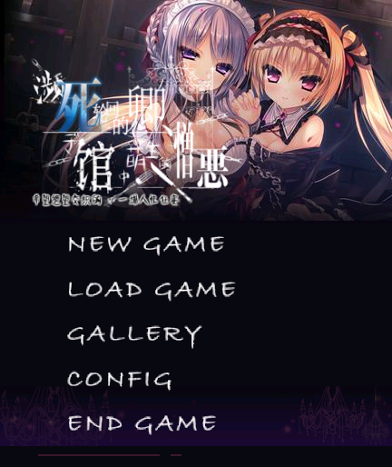
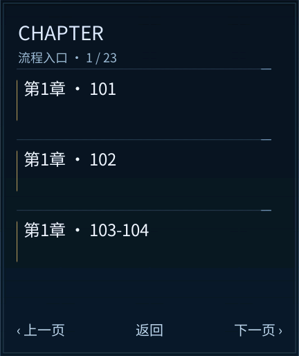
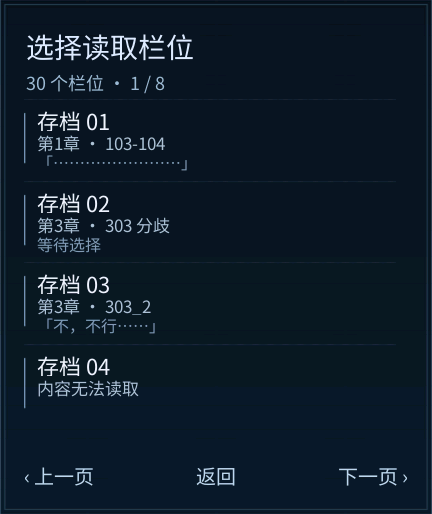

# 《死に逝く君、館に芽吹く憎悪》· REDMI Watch 5 移植版

当前版本 **0.3.7 / versionCode 95**，屏幕 **432×514**，包名 `com.codex.yakata.rw5`。
安装包 **14,552,289 字节（约 14.55 MB）**，低于 25,000,000 字节上限。
SHA-256：`6dcbbeff2ac17fc8d5ec41f3b5bb419ba673289de6a4077dbba5809af319c8da`

作者：**xuanyide**。基础移植（剧情、翻译、画面、引擎、字库）由 **DeepSeek** 完成；0.3.6–0.3.7 的 UI 重设计与问题修复由 **Codex** 完成。

## 下载

| 文件 | 说明 |
| --- | --- |
| [release/0.3.7/死馆-RW5-0.3.7.rpk](release/0.3.7/死馆-RW5-0.3.7.rpk) | 安装包（14.55 MB），手表直接安装 |
| [release/0.3.7/SHA256SUMS.txt](release/0.3.7/SHA256SUMS.txt) | 校验和 |
| [release/0.3.7/交付核验.json](release/0.3.7/交付核验.json) | 构建校验结果 |
| [release/0.3.7/死馆-RW5-0.3.7-UI源码与工具补丁.zip](release/0.3.7/死馆-RW5-0.3.7-UI源码与工具补丁.zip) | 覆盖到已有 0.3.6 工程的 UI 补丁（含页面、贴图、构建脚本、测试） |

## 内容规模

- **剧情**：69 个原作脚本、99 个源场景 → 198 个运行时页面，**17,394 条正文**，11 处选项全部保留分支。
- **画面**：682 张舞台／CG 图，**56 组** CG 鉴赏（14 页，2×2 网格）。
- **立绘**：277 张，按原作 `env` 逐帧判定出场／退场，CG 帧不叠立绘。
- **完整收录**：成人／猎奇内容按原作全量保留并照原文翻译，未删减。
- **未包含**：语音、BGM、OP 影片（原作约 800 MB 音频与视频不入包）。
- **存档**：30 个栏位，覆盖前确认；`schema=1`，含 8 步历史。

## 功能

- 点击推进、拖动浏览；未显示完时点击补全句子，再点进入下一句。
- 字号标准／大号，逐字／即时两档，自动播放三档速度（设置本地保存）。
- 阅读菜单：保存、读取、下一章、自动、速度、阅读设置。
- 章节选择（23 页）、30 位存读档（8 页）、CG 鉴赏（14 页）、阅读设置。
- 鉴赏内点按切换差分，返回时回到进入前的那一页。
- END GAME 清理计时器与过期读取回调后调用 `this.$app.exit()`；写存档期间不会中断。

| 标题 | 章节 |
| --- | --- |
|  |  |

| 阅读菜单 | 存档 |
| --- | --- |
|  |  |

## 安装

1. 安装 `死馆-RW5-0.3.7.rpk`（或字节相同的 `.bin`）。
2. 若设备上已有旧版本，先卸载再装；卸载会清除应用数据里的存档，升级前请保留旧包。
3. 安装后若界面显示「!」占位，退出应用重新打开即可（旧进程仍持有上一版文件）。
4. 若黑屏或卡住，先按返回键离开，必要时正常重启，再读取较早存档。
5. 不要把恢复出厂设置当作安装异常的处理手段。

## 验证范围

- **15 项 Node 测试**通过（引擎、生命周期、路线、UI 控件）。
- **包审计**：外层／内层签名、ZIP CRC、全部文件摘要（912 个签名文件）、字体覆盖、圆形图标、UI 边界。
- **官方 Vela 模拟器**（`YakataRW5-432x514`、432×514、128 MiB）：安装、标题、阅读、菜单（自动／速度即时生效）、章节、存读档、CG 鉴赏、设置、END GAME 退出均实测；截图见 [docs/screenshots/0.3.7](docs/screenshots/0.3.7)。
- 报告见 [reports](reports)。模拟器不代表实机固件与内存表现；**物理手表仍待复测**。

## 版本历史

| 版本 | 变更 |
| --- | --- |
| 0.3.7 | END GAME 真正退出；菜单自动／速度即时生效；所有菜单全屏遮挡，边缘不再透出场景 |
| 0.3.6 | 标题与全局 UI 按原作重做（原作字体、按钮贴图、去掉蓝色边框） |
| 0.3.5 | 标题字标改用原作内嵌字体；END GAME 取代 CHAPTER；入口对齐原版顺序 |
| 0.3.1 | 背景／CG 判定改为「图层存在即显示」，黑屏帧 1,276 → 270；鉴赏返回保留页码 |
| 0.2.9 | 立绘按 `env` 逐帧判定（12,252 → 7,035）；EXTRA 2×2；菜单全屏 |
| 0.2.6 | 按原作冷色调重做 UI 底板、按钮、卡片 |
| 0.2.3 | 全量剧情＋全 CG＋全立绘首次齐备 |

## 仓库结构

- `release/` —— 发布包与校验和
- `docs/` —— 交接文档、UI 规格（`0.3.7/ui-spec.json`：贴图清单、CSS 原文、调色板）、截图
- `src/` `tools/` `tests/` —— 本轮 UI 实现的可编译子集（不含剧情、CG、立绘、字库）
- `reports/` —— 审计与实测报告

## 许可与致谢

自编代码采用 [MIT](LICENSE)。原作剧本、图像、字体及其它素材的著作权归原作者与发行方所有，MIT 不授予原作素材的任何使用权；本仓库仅作个人移植存档与学习用途，请在下载后 24 小时内删除并支持正版。

感谢“表盘自定义工具”相关团队提供的工具：[米坛社区](https://www.bandbbs.cn/)。

联系：**shining237841@gmail.com**
