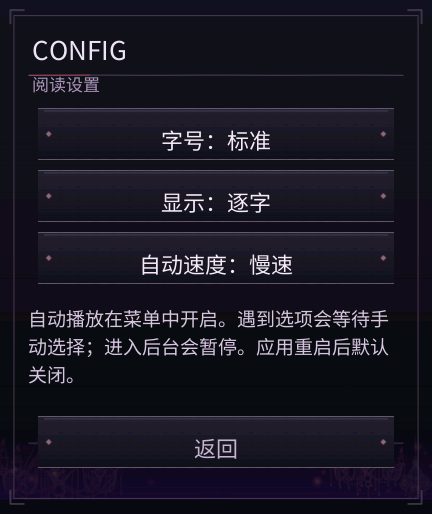

# 《死馆》REDMI Watch 5 · UI 源码补丁

**0.3.7 / versionCode 95**。作者：**xuanyide**。本仓库公开本轮 UI 实现、非剧情界面素材、测试和交接文档；不包含原作剧情、CG、立绘、完整游戏安装包或字库，也不是可直接安装的完整游戏。

基础工程由 DeepSeek 提供，本轮 UI 重设计和问题修复由 **Codex** 完成。2026-11-05，用户确认本轮修改通过并授权上传。

## 本轮改动

- 标题界面使用原作 NEW GAME、LOAD GAME、GALLERY、CONFIG、END GAME 按键及其选中状态，统一靠左。
- END GAME 清理计时器和过期读取回调后调用 `this.$app.exit()`；存档写入期间不会中断写入。
- 菜单的“自动”和“速度”改为独立点击按钮，状态即时刷新；自动播放返回正文后继续，在选项处暂停，三档速度保存到本地。
- 菜单、设置、存读档、章节、鉴赏及选项界面使用不透明全屏底层，避免边缘透出游戏场景。
- 保持既有运行框架、剧情控制逻辑、包名和存档格式。

| 菜单 | 设置 |
| --- | --- |
|  |  |

截图来自使用自编短句和纯色测试画面的隔离 UI 测试应用，不含原作剧情。

## 使用与验证

这是覆盖到已有工程的 UI 补丁。合并前备份工程和存档；所需基础文件及构建条件见 [交接文档](docs/HANDOFF.md)。公开文件中的页面、引擎和界面图片保持验收工程原始字节，仓库文档与 npm 描述另行整理。

仅运行本仓库独立的三项 UI 控制测试，无须原作资源：

```sh
npm test
```

完整本地工程的 15 项测试、安装包签名/摘要检查、原生模拟器菜单与退出生命周期检查均通过。隔离 UI 包还验证了自动推进到选项，以及 14 组界面边缘检查。报告保存在 [reports](reports)。完整工程的 15 项测试与公开子集的三项测试范围不同。

通用 Vela 镜像没有系统 HOME 启动器，退出后为黑屏；日志确认应用已关闭和资源销毁。本轮本地验证不代表全部路线、长期运行或新的实机测试均已完成。用户已确认本轮修改通过，未单独记录验收设备。

## 许可与致谢

自编代码采用 [MIT](LICENSE)。原作按键、界面装饰及第三方组件的权利仍归相应权利人，MIT 不授予原作素材使用权。

感谢 DeepSeek 提供基础工程；感谢“表盘自定义工具”相关团队提供的工具：[米坛社区](https://www.bandbbs.cn/)。

联系：**shining237841@gmail.com**。
